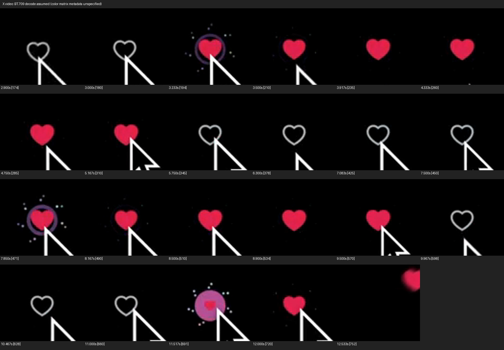

# Đối chiếu animation native

Đã xem các frame trong [video gốc trên X](https://x.com/ngocdevv/status/1982572513445204344)
và đối chiếu với source React Native, Swift và Kotlin. Hai bản native giữ các
thông số và hành vi của source. Đã chạy tương tác trên iPhone 18 Pro / iOS
27.2 và Android sdk_gphone64_arm64 / API 36; thích/bỏ thích đạt trên cả hai,
chạm nhanh 5 lần đạt trên iOS. [Báo cáo QA và video thực tế](qa/README.md)
ghi rõ các mục Android còn chờ và giới hạn của bản ghi.

## Video tham chiếu

Video truy xuất từ [metadata công khai của X](https://cdn.syndication.twimg.com/tweet-result?id=1982572513445204344&lang=en&token=1).
[MP4 gốc](https://video.twimg.com/amplify_video/1982564332241100800/vid/avc1/1152x720/eurknWYI6rQ8oXF6.mp4?tag=14)
có kích thước 1152 × 720, 60 fps, 836 frame, dài khoảng 13,933 giây.
`video.gif` trong repository là bản demo dài 13,92 giây, phù hợp với cùng
đoạn ghi hình.

Video cho thấy tim viền xám trên nền đen. Khi thích, vòng hồng/tím nở ra,
14 hạt theo 7 cặp tỏa quanh tim, tim đỏ lớn lên, thu nhẹ rồi lớn trở lại.
Khi bỏ thích, vòng và hạt biến mất ngay, tim chuyển về viền xám.

Các mốc quan sát trong MP4, tính gần đúng từ frame hiển thị:

| Lần tương tác | Quan sát |
| --- | --- |
| Thích lần 1 | Hiệu ứng xuất hiện khoảng 3,017 s; tim lớn khoảng 3,167–3,217 s, thu nhẹ khoảng 3,383 s, ổn định khoảng 3,733 s |
| Bỏ thích lần 1 | Khoảng 5,417–5,600 s |
| Bỏ thích lần 2 | Khoảng 9,517–9,717 s |
| Thích lần 3 | Khoảng 11,417–12,317 s |

Mốc bắt đầu trong video không xác định chính xác thời điểm callback chạm.
Các khoảng trên phù hợp với duration 1000 ms khi thích và 200 ms khi bỏ
thích trong source; không dùng chúng để thay thế duration của source.

MP4 không khai báo ma trận màu. Ảnh đối chiếu được giải mã với giả định
BT.709: màu giữa tim đã thích xấp xỉ RGB (226, 34, 76), gần màu source
(226, 38, 77). Vì video có nén và thiếu metadata màu, không dùng màu pixel
video để thay các token màu gốc hoặc khẳng định trùng màu từng pixel.

## Những thông số được giữ trên cả hai nền tảng

| Thành phần | Swift / Kotlin tương ứng source |
| --- | --- |
| Bố cục | Nền đen, nút ở giữa, canvas 58 pt / 58 dp, tâm (29, 29) |
| Hình tim | Cùng đường SVG từ source, tỷ lệ 26/24 quanh tâm SVG (12, 12); không thay bằng SF Symbol hoặc Material icon |
| Màu tim | Viền `#AAB8C2`, fill `#E2264D`; chuyển từ stroke sang fill tại progress 0,03 |
| Nét viền | Stroke width 2 trong hệ tọa độ SVG; chịu cả transform 26/24 và transform animation như Skia |
| Nhịp thích | 1000 ms, cubic Bézier (0,21; 0,61; 0,35; 1) |
| Nhịp bỏ thích | 200 ms, cubic Bézier (0,42; 0; 1; 1), tương đương `Easing.ease` của Reanimated 4.1.1 |
| Scale tim | Progress [0; 0,75; 0,9; 1] → [0; 1,15; 1; 1,15]; riêng progress = 0 có scale = 1 |
| Vòng màu | Bán kính ngoài 16; lỗ trong tăng 0 → 5 → 12 → 16 bằng even-odd fill; giữ nguyên các mốc opacity và màu hồng/tím/lavender |
| Hạt | 7 nhóm × 2 hạt; góc nhóm bắt đầu −π/2, phân bố đều; bán kính nhóm 20, độ lệch cặp 2, góc lệch 40° |
| Độ trễ cặp | Hạt thứ hai dùng `progress − 0,08`; đây là độ trễ theo progress sau easing, không phải delay 80 ms |
| Màu hạt | Cùng 14 cặp màu start/end trong `constants.ts`; nội suy từng kênh RGB, clamp như Skia |
| Chạm liên tiếp | Hủy timing cũ, tiếp tục từ progress hiện tại tới trạng thái mới; không cho nhiều animation chạy chồng nhau |
| Feedback / API | Haptic khi thích; có trạng thái khởi tạo, callback toggle và chế độ debug khóa tương tác |

## Hai chi tiết của source cần giữ để khớp video

Trong React Native, scale có 4 mốc input nhưng 5 giá trị output:
`[0, 1.15, 1, 1.15, 1]`. Reanimated 4.1.1 dùng số mốc input, nên giá trị
`1` cuối cùng không được sử dụng. Trạng thái đã thích thực tế có scale
`1.15`. Hai bản native dùng trực tiếp 4 giá trị có hiệu lực, giữ nhịp tim
lớn → thu nhẹ → lớn trở lại nhìn thấy trong video.

Độ trễ của hạt thứ hai khiến progress cuối của nó bằng `0.92`. Vì thế
bán kính hạt còn khoảng `0.426667` và opacity `0.2` khi kết thúc. Video
gốc vẫn có các chấm rất mờ ở trạng thái đã thích. Hai bản native giữ
chi tiết này; khi bỏ thích thì ẩn toàn bộ hạt ngay như source.

Đã kiểm tra hành vi nội suy bằng source chính thức của
[Reanimated 4.1.1](https://github.com/software-mansion/react-native-reanimated/blob/4.1.1/packages/react-native-reanimated/src/interpolation.ts),
[Easing 4.1.1](https://github.com/software-mansion/react-native-reanimated/blob/4.1.1/packages/react-native-reanimated/src/Easing.ts)
và [Skia 2.2.12](https://github.com/Shopify/react-native-skia/blob/v2.2.12/packages/skia/src/animation/functions/interpolateColors.ts).

## Kiểm tra build, số học và máy ảo

Đã build thành công iOS cho đích generic iOS Simulator (arm64 và x86_64).
Model Swift được so với phép tính từ source React Native ở 21 mẫu progress/
thời gian và 14 hạt: 2.865 so sánh số học đều đạt. Android đã qua
`assembleDebug`, 4 test `testDebugUnitTest` đối chiếu source và `lint`.
Lint có 0 lỗi, 4 cảnh báo về phiên bản Gradle, khóa portrait và cấu hình
backup; không ảnh hưởng build demo.

Đã cài và chạy demo trên hai máy ảo. Thích/bỏ thích hiển thị đúng hình
tim, vòng và 14 hạt; trạng thái bỏ thích khôi phục vùng tim như ban đầu.
Chạm nhanh 5 lần trên iOS kết thúc ở trạng thái đã thích. Android đã sửa
lỗi khởi chạy bằng cách gọi `configureSystemBars()` sau `setContentView()`.
Chuỗi 3 và 4 click native trên Android kết thúc đúng trạng thái; lượt tap
khoảng 100 ms còn giới hạn xác nhận qua transport, nêu rõ trong báo cáo.
Ảnh và bản ghi nằm trong [báo cáo QA](qa/README.md).

Video iOS hỗ trợ nhịp thích khoảng 1 giây và bỏ thích khoảng 200 ms.
Video Android có frame lặp/nhảy pha, nên chưa dùng để xác nhận thời gian
hoặc độ mượt. Chưa chứng nhận FPS hay haptic trên thiết bị thật. Hai bản
native giữ màu source hiện tại; viền trong video X cũ xám trung tính hơn.
Do nén video, metadata màu và rasterization khác nhau, chưa khẳng định
ảnh native trùng từng pixel với video X.
