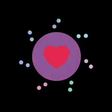
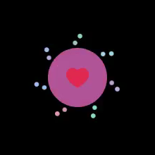

# QA trên máy ảo

Ngày kiểm tra: 10/10/2026.

Đã chạy app native trên **iPhone 18 Pro / iOS 27.2** và
**sdk_gphone64_arm64 / Android API 36**, đồng thời xem frame từ video X
để đối chiếu hình tim, vòng màu, hạt và trạng thái kết thúc.

| Kiểm tra | iOS | Android |
| --- | --- | --- |
| Khởi chạy, tim viền giữa nền đen | Đạt | Đạt sau khi sửa lỗi khởi chạy |
| Thích: vòng nở rồi rỗng, 14 hạt theo 7 cặp | Đạt | Đạt |
| Tim lớn → thu nhẹ → lớn lại, giữ scale 1,15 | Đạt | Đạt |
| Bỏ thích: ẩn vòng/hạt, trở về tim viền | Đạt; vùng tim khớp ảnh ban đầu | Đạt; vùng tim khớp ảnh ban đầu |
| Chạm liên tiếp khi hiệu ứng đang chạy | Đạt với 5 lần; cuối đã thích | Đạt với 3 lần → đã thích, 4 lần → chưa thích |
| Ra nền rồi quay lại | Chưa đánh giá trong đợt này | Đạt; giữ tim đỏ và trạng thái đã thích |
| Activity tạo lại / khôi phục sau process death | Không áp dụng Activity | Chưa kiểm tra |

Android từng crash lúc mở app vì `configureSystemBars()` truy cập
`WindowInsetsController` trước khi decor được tạo. Đã chuyển lời gọi này
sau `setContentView()`, build/cài lại và kiểm tra mở app thành công.
[Log lỗi ban đầu](android/00-launch-crash.txt) được giữ để đối chiếu.

Máy ảo iOS bổ sung từng làm host quá tải và transport bị timeout.
Đã dừng riêng máy ảo đó; điều khiển Android hoạt động lại.
Chuỗi 4 click native được xác nhận qua callback với khoảng cách thực tế
264–292 ms, kết thúc chưa thích. Một lượt gửi 4 tap cách nhau khoảng
100 ms chỉ ghi nhận 3 callback native, nên chưa xác nhận độ tin cậy ở
tần suất đó; phản hồi “tapped” của công cụ không chứng minh đủ 4 click.
Không sửa touch dispatch khi chưa xác định được nguyên nhân.

## Bằng chứng

- iOS: [video tương tác](ios/animation.mp4), [các frame chi tiết](ios/animation-detail.png), [ban đầu](ios/idle.png), [đã thích](ios/liked.png), [đã bỏ thích](ios/unliked.png).
- Android: [video tương tác](android/animation.mp4), [các frame chi tiết](android/animation-detail.png), [ban đầu](android/01-idle.png), [ảnh trở về ban đầu](android/idle-restored-diff/current-035d0e34.live.png), [thiết bị](android/device.json).
- Chạm liên tiếp Android: [3 lần](android/03-rapid-odd.png), [4 lần](android/04-rapid-even.png), [callback native](android/interaction-log.txt).
- Quay lại app Android: [trước khi ra nền](android/05-before-background.png), [sau khi quay lại](android/06-foreground-return.png), [kết quả và AX](android/results.json).

| Burst iOS | Burst Android |
| --- | --- |
|  |  |

Phân tích frame đếm được 14 hạt trên cả hai nền tảng. Tim đã thích trên
iOS có kích thước khoảng 74 × 66 pixel ở mật độ 3×, phù hợp hình SVG
scale 1,15; Android cũng giữ tỷ lệ này ở mật độ màn hình của máy ảo.
Ảnh PNG giữ đúng màu source: fill `#E2264D`, viền `#AAB8C2`.

## Giới hạn kết luận

Video iOS cho thấy nhịp thích khoảng 1 giây và bỏ thích khoảng 0,2 giây.
Video Android có frame lặp/nhảy pha và timestamp không khớp thời gian
của thao tác qua công cụ; chỉ dùng để xác nhận trạng thái và hình ảnh.
Duration 1000/200 ms đã được đối chiếu riêng trong code và kiểm tra số học.
Đợt này **chưa chứng nhận FPS, độ mượt trên thiết bị thật hoặc haptic**.

Viền trong video X cũ có màu xám trung tính; source hiện tại và hai bản
native dùng xám hơi xanh `#AAB8C2`. Video X bị nén, thiếu metadata màu
và được giải mã với giả định BT.709; ảnh native có cách raster hóa khác.
Vì vậy không khẳng định ảnh trùng từng pixel với video X.

Xem thêm [đối chiếu thông số, source và build](../native-parity.md).
